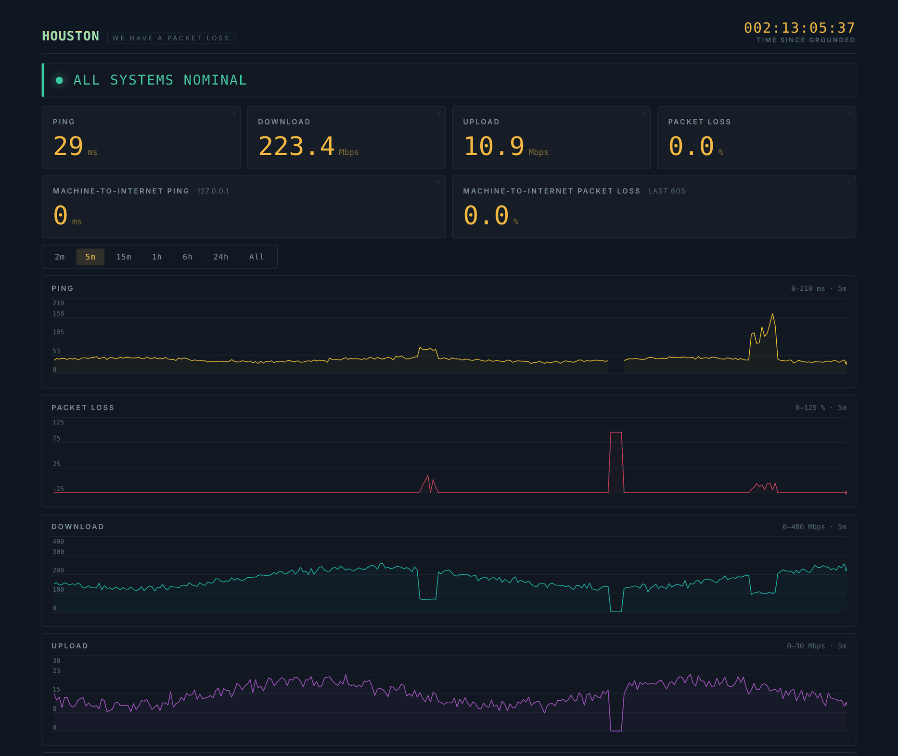
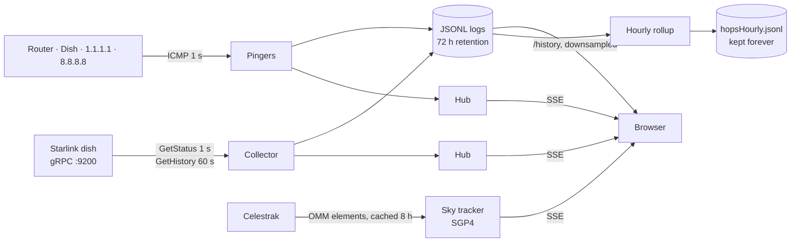

# Houston, We Have a Packet Loss

[](https://github.com/Svemeh/houston-we-have-a-packet-loss/actions/workflows/ci.yml)

A self-hosted Starlink link monitor written in Go. It polls the dish's local gRPC API, pings every hop
between the PC and the internet once a second, and serves a live dashboard — so when a game stutters
you can see *where* the packets died, not just that they did.


<sub>Dashboard running with <code>-fake</code> (synthetic dish data).</sub>

## Why

The Starlink app reported a healthy connection while online games kept lagging. Averages hid the problem,
and the app has no way to tell local network trouble from the satellite link from the wider internet.
This tool measures each of those separately, at one-second resolution, and keeps the history.

## What it found

Three days of data (~253k one-second rounds) from a Gen 3 Standard dish:

| Finding | Evidence |
|---|---|
| **The LAN is clean.** | Loss to router 0.003 %, to dish 0.004 %, vs 0.19 % to `1.1.1.1`. |
| **Satellite handovers cause a large share of loss.** | Starlink reassigns satellites every 15 s. Loss is **10× higher** at one fixed second of that cycle — 198 of 485 lost seconds (≈40 %) land there. The dish's own drop counter shows the same 15 s rhythm, independently. |
| **Latency spikes, not average loss, break games.** | p50 39 ms, p99 106 ms, max 571 ms, jitter p99 55 ms. A second that is lost or over 120 ms happens ~27 times an hour. |
| **The dish under-reports.** | It logged 29 outages in 3 days; only 25 of the 485 lost seconds fall inside one. |
| **Some loss is not Starlink's.** | About half of the lost seconds also lost `8.8.8.8` (Starlink side); the rest were specific to the Cloudflare path. |

Conclusion: nothing on the local network needs fixing. Handover loss is inherent to the service, so the
useful alarm is on loss *outside* the handover second — which the hourly rollup now measures.

## Features

- **Live dashboard** — latency, loss, throughput, link state and alarm strip, streamed over Server-Sent Events. Opens with 45 minutes of backfill; ranges up to 24 h.
- **Per-hop pinger** — router (found from the default gateway), dish, Cloudflare and Google pinged in parallel each second, so a loss can be pinned to a segment of the path.
- **Dish telemetry** — status and outage history from the dish's gRPC API, including fields newer than the published protobufs (decoded by tag from the unknown-field bytes).
- **Hourly rollup** — loss, RTT p50/p90/p99/max and jitter per target, plus loss bucketed by second within the 15 s satellite slot. Kept forever at ~600 B/hour.
- **Satellite sky view** — on the dashboard: every Starlink satellite above the horizon, propagated from Celestrak orbital elements (OMM) with SGP4.
- **Fake mode** — a synthetic dish that cycles through degraded, obstructed, no-signal and offline states, so the UI can be developed without hardware.
- **Single binary, no database** — static files are embedded; data is append-only JSON Lines, pruned by atomic rewrite.

## Architecture



Engineering notes:

- **Generic fan-out** — `Hub[T]` and `LogFile[T]` serve every data stream (dish, ping, hops, outages, rollups) with one implementation. Slow browsers drop updates rather than stall the others.
- **Worst-case downsampling** — long ranges are bucketed by *time* and keep each bucket's worst reading. Averaging would hide the three-second dropouts the tool exists to show, and time buckets keep outages visible as gaps.
- **Cheap range reads** — history requests seek to an estimated tail offset and re-read from the start only if the estimate fell short.
- **Crash-safe pruning** — logs are rewritten to a temp file and atomically renamed.
- **Restart-safe rollup** — summaries are computed from the on-disk log, not memory, so hours missed while the app was down are filled in on the next run.
- **GPS time** — dish outage timestamps use the GPS epoch without leap seconds and are converted on read.

## Install

**macOS / Linux**

```sh
curl -fsSL https://raw.githubusercontent.com/Svemeh/houston-we-have-a-packet-loss/main/install.sh | sh
```

**Windows** (PowerShell)

```powershell
irm https://raw.githubusercontent.com/Svemeh/houston-we-have-a-packet-loss/main/install.ps1 | iex
```

The installer downloads the latest release, checks its checksum, sets Houston up to run in the background
and opens the dashboard at <http://localhost:2101>. Set your location once in the dashboard's **Sky View** card. Run the
same command again to update.

| | Runs | Data | Needs |
|---|---|---|---|
| macOS | at login (LaunchAgent); installed over SSH: at boot (LaunchDaemon) | `~/Library/Application Support/Houston` | nothing; sudo over SSH |
| Linux | at boot (systemd) | `/var/lib/houston` | sudo |
| Windows | at startup (scheduled task) | `C:\ProgramData\Houston` | admin, once |

To uninstall (data is kept): `curl -fsSL …/install.sh | sh -s -- uninstall` on macOS/Linux, or
`& ([scriptblock]::Create((irm …/install.ps1))) -Uninstall` in PowerShell.

### Docker

For a Linux machine that already runs Docker (home server, NAS, Raspberry Pi):

```sh
docker run -d --name houston --restart unless-stopped --network host \
  -v houston-data:/app/data ghcr.io/svemeh/houston-we-have-a-packet-loss
```

or `docker compose up -d` with [`compose.yml`](compose.yml). Host networking lets Houston find the real LAN
router and keeps Docker's NAT out of the ping times. On a Mac or Windows PC use the installer instead: Docker
Desktop runs containers in a VM, and that extra hop shows up in every ping.

The image runs as a non-root user, so pinging relies on the host allowing ping sockets, the default on
current distros. If the hops log `permission denied`:
`sudo sysctl -w net.ipv4.ping_group_range="0 2147483647"`.

## Running from source

Requires Go 1.26+ and a Starlink dish on the local network (or `-fake`).

```sh
go run .                      # dashboard on http://localhost:2101
```

Test without starlink:
```sh
go run . -fake                # synthetic dish, no starlink required
```

Quickly test reachability:
```sh
go run . -oneshot             # check dish + internet reachability and exit
```

The dashboard's Sky View card asks for your location the first time and saves it to `data/settings.json`. To set it
outside the browser, use `HOUSTON_LAT` / `HOUSTON_LON` in the environment or in `.env`
(see [`.env.example`](.env.example)); those win over the saved one.

ICMP needs permission on Linux: `sudo sysctl -w net.ipv4.ping_group_range="0 2147483647"`, or run with `CAP_NET_RAW`.

| Flag | Default | |
|---|---|---|
| `-addr` | `192.168.100.1:9200` | Dish gRPC address |
| `-web` | `:2101` | Dashboard listen address |
| `-fake` | off | Synthetic telemetry |
| `-router` | `auto` | LAN router for the hop pinger: `auto` (default gateway), an IP, or `none` |
| `-ping-target` | `1.1.1.1` | Host this machine pings |
| `-no-ping` / `-no-hops` | off | Disable the pingers (`-no-hops` also disables the rollup) |
| `-log`, `-ping-log`, `-hops-log`, `-outage-log`, `-rollup-log` | `data/*.jsonl` | Log locations |
| `-version` | | Print the version and exit |

Intervals, retention and thresholds live in [`const.go`](const.go).

### HTTP endpoints

| Route | |
|---|---|
| `/` | Dashboard |
| `/events` · `/pingevents` · `/skyevents` | SSE streams |
| `/history?range=1h` · `/pinghistory?range=1h` | Downsampled history (`range` = Go duration or `all`) |
| `/log` · `/pinglog` | Raw JSONL |
| `/location` | Observer location: `GET`, or `POST` JSON `{"latitude_deg":…,"longitude_deg":…}` |

## Project layout

| File | Responsibility |
|---|---|
| `main.go` | Flags, wiring, poll and prune loops |
| `const.go` | Tunables and the telemetry sample format |
| `antenna.go` · `fakeAntenna.go` | Dish gRPC collector · synthetic collector |
| `outages.go` | Dish outage history, protobuf decoding, GPS time |
| `ping.go` · `hops.go` | Single-target and per-hop ICMP pingers |
| `gateway*.go` | Finds the LAN router from the default gateway |
| `rollup.go` | Hourly summary with handover-slot bucketing |
| `logFile.go` | JSONL persistence, pruning, range reads, downsampling |
| `hub.go` · `server.go` | SSE fan-out and HTTP routes |
| `sky.go` · `settings.go` | TLE fetch/cache and SGP4 propagation · location saved from the dashboard |
| `static/` | Dashboard (vanilla JS, canvas charts) |
| `install.sh` · `install.ps1` | Installers (macOS/Linux · Windows) |

## Testing

```sh
go test -race ./...
```

Covers the rollup statistics and handover bucketing, both downsamplers, protobuf outage decoding, log append/prune/read, hub backpressure and the link-state heuristic.

### CI

Every pull request and push to `main` runs [`ci.yml`](.github/workflows/ci.yml):

| Check | What it does |
| --- | --- |
| `lint` | `gofmt`, `go mod tidy`, LF line endings, `go vet`, staticcheck |
| `test` | `go test -race` on Linux, macOS and Windows |
| `build` | GoReleaser snapshot: all release binaries and `checksums.txt`, nothing published |
| `install` | Installs those binaries with `install.sh` / `install.ps1` on each OS, checks the dashboard answers, uninstalls |
| `scripts` | shellcheck on `install.sh`, PSScriptAnalyzer on `install.ps1` |
| `docker` | Builds the image for amd64, arm64 and arm/v7, then starts it with `-fake` and checks the dashboard |
| `ci-ok` | Passes only if all of the above passed; the required check for merging |

[`vulncheck.yml`](.github/workflows/vulncheck.yml) runs govulncheck on pull requests and weekly. It reports
known vulnerabilities in Go and dependencies but doesn't block merging.

A `v*` tag runs the same CI checks before [`release.yml`](.github/workflows/release.yml) publishes binaries and the Docker image.

## Known limitations

- The hourly rollup is written to disk but not yet shown on the dashboard.
- The dish's own drop counter reports ~3 s late relative to the pings.

