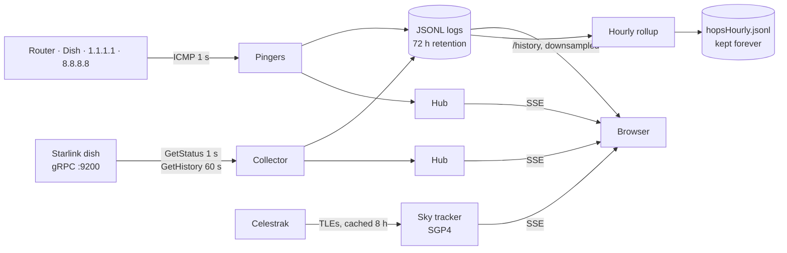

# Houston, We Have a Packet Loss

[](https://github.com/Svemeh/houston-we-have-a-packet-loss/actions/workflows/ci.yml)

A self-hosted Starlink link monitor written in Go. It polls the dish's local gRPC API, pings every hop
between the PC and the internet once a second, and serves a live dashboard — so when a game stutters
you can see *where* the packets died, not just that they did.


<sub>Dashboard running with <code>-fake</code> (synthetic dish data).</sub>

## Why

The Starlink app reported a healthy connection while online games kept lagging. Averages hid the problem,
and the app has no way to tell local network trouble from the satellite link from the wider internet.
This tool measures each of those separately, at one-second resolution, and keeps the history.

## What it found

Three days of data (~253k one-second rounds) from a Gen 3 Standard dish:

| Finding | Evidence |
|---|---|
| **The LAN is clean.** | Loss to router 0.003 %, to dish 0.004 %, vs 0.19 % to `1.1.1.1`. |
| **Satellite handovers cause a large share of loss.** | Starlink reassigns satellites every 15 s. Loss is **10× higher** at one fixed second of that cycle — 198 of 485 lost seconds (≈40 %) land there. The dish's own drop counter shows the same 15 s rhythm, independently. |
| **Latency spikes, not average loss, break games.** | p50 39 ms, p99 106 ms, max 571 ms, jitter p99 55 ms. A second that is lost or over 120 ms happens ~27 times an hour. |
| **The dish under-reports.** | It logged 29 outages in 3 days; only 25 of the 485 lost seconds fall inside one. |
| **Some loss is not Starlink's.** | About half of the lost seconds also lost `8.8.8.8` (Starlink side); the rest were specific to the Cloudflare path. |

Conclusion: nothing on the local network needs fixing. Handover loss is inherent to the service, so the
useful alarm is on loss *outside* the handover second — which the hourly rollup now measures.

## Features

- **Live dashboard** — latency, loss, throughput, link state and alarm strip, streamed over Server-Sent Events. Opens with 45 minutes of backfill; ranges up to 24 h.
- **Per-hop pinger** — router, dish, Cloudflare and Google pinged in parallel each second, so a loss can be pinned to a segment of the path.
- **Dish telemetry** — status and outage history from the dish's gRPC API, including fields newer than the published protobufs (decoded by tag from the unknown-field bytes).
- **Hourly rollup** — loss, RTT p50/p90/p99/max and jitter per target, plus loss bucketed by second within the 15 s satellite slot. Kept forever at ~600 B/hour.
- **Satellite sky view** (`/sky`) — every Starlink satellite above the horizon, propagated from Celestrak TLEs with SGP4.
- **Fake mode** — a synthetic dish that cycles through degraded, obstructed, no-signal and offline states, so the UI can be developed without hardware.
- **Single binary, no database** — static files are embedded; data is append-only JSON Lines, pruned by atomic rewrite.

## Architecture



Engineering notes:

- **Generic fan-out** — `Hub[T]` and `LogFile[T]` serve every data stream (dish, ping, hops, outages, rollups) with one implementation. Slow browsers drop updates rather than stall the others.
- **Worst-case downsampling** — long ranges are bucketed by *time* and keep each bucket's worst reading. Averaging would hide the three-second dropouts the tool exists to show, and time buckets keep outages visible as gaps.
- **Cheap range reads** — history requests seek to an estimated tail offset and re-read from the start only if the estimate fell short.
- **Crash-safe pruning** — logs are rewritten to a temp file and atomically renamed.
- **Restart-safe rollup** — summaries are computed from the on-disk log, not memory, so hours missed while the app was down are filled in on the next run.
- **GPS time** — dish outage timestamps use the GPS epoch without leap seconds and are converted on read.

## Running it

Requires Go 1.25+ and a Starlink dish on the local network (or `-fake`).

```sh
cp .env.example .env          # set HOUSTON_LAT / HOUSTON_LON for the sky view
go run .                      # dashboard on http://localhost:2101
go run . -fake                # synthetic dish, no hardware needed
go run . -oneshot             # check dish + internet reachability and exit
```

ICMP needs permission on Linux: `sudo sysctl -w net.ipv4.ping_group_range="0 2147483647"`, or run with `CAP_NET_RAW`.

| Flag | Default | |
|---|---|---|
| `-addr` | `192.168.100.1:9200` | Dish gRPC address |
| `-web` | `:2101` | Dashboard listen address |
| `-fake` | off | Synthetic telemetry |
| `-ping-target` | `1.1.1.1` | Host this machine pings |
| `-no-ping` / `-no-hops` | off | Disable the pingers (`-no-hops` also disables the rollup) |
| `-log`, `-ping-log`, `-hops-log`, `-outage-log`, `-rollup-log` | `data/*.jsonl` | Log locations |

Hop targets, intervals, retention and thresholds live in [`const.go`](const.go).

### HTTP endpoints

| Route | |
|---|---|
| `/` · `/sky` | Dashboard · satellite view |
| `/events` · `/pingevents` · `/skyevents` | SSE streams |
| `/history?range=1h` · `/pinghistory?range=1h` | Downsampled history (`range` = Go duration or `all`) |
| `/log` · `/pinglog` | Raw JSONL |

## Project layout

| File | Responsibility |
|---|---|
| `main.go` | Flags, wiring, poll and prune loops |
| `const.go` | Tunables and the telemetry sample format |
| `antenna.go` · `fakeAntenna.go` | Dish gRPC collector · synthetic collector |
| `outages.go` | Dish outage history, protobuf decoding, GPS time |
| `ping.go` · `hops.go` | Single-target and per-hop ICMP pingers |
| `rollup.go` | Hourly summary with handover-slot bucketing |
| `logFile.go` | JSONL persistence, pruning, range reads, downsampling |
| `hub.go` · `server.go` | SSE fan-out and HTTP routes |
| `sky.go` | TLE fetch/cache and SGP4 propagation |
| `static/` | Dashboard and sky view (vanilla JS, canvas charts) |

## Testing

```sh
go test -race ./...
```

Covers the rollup statistics and handover bucketing, both downsamplers, protobuf outage decoding, log
append/prune/read, hub backpressure and the link-state heuristic. CI runs `gofmt`, `go vet`, tests and a build on every push.

## Known limitations

- The hop pinger waits for every target each round, so a timeout can skip a tick (~3.5 % of rounds). This smears the handover slot, so the 10× figure is likely an underestimate.
- The hourly rollup is written to disk but not yet shown on the dashboard.
- The dish's own drop counter reports ~3 s late relative to the pings.

